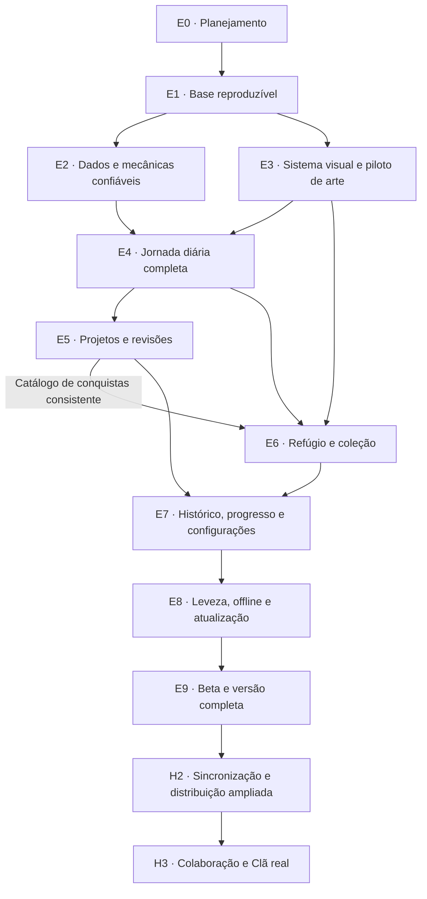

# Level Me Up — roadmap de produto e execução

Atualizado em 29/10/2026 · Versão 1 do planejamento

**Objetivo:** evoluir o protótipo atual para um aplicativo pessoal de desenvolvimento e estudos com uma jornada diária simples, progresso confiável e uma identidade de fantasia consistente. Entregar por etapas utilizáveis, preservando os dados e permitindo incorporar a personalidade do autor ao longo do caminho.

**Estado deste documento:** E0 a E7 concluídas; próxima tarefa E8-01. E7: commits locais 347a990 e 4e0bedf integrados em D:, 120 testes de serviços e 106 cenários de produção aprovados, mais 16 cenários da Alpha 2 repetidos na revisão final. Meu progresso e Configurações usam dados reais e conforto global em http://127.0.0.1:5174/progresso. Evidências em entregas/E7/RESULTADO.md.

## 1. Decisões que orientam o trabalho

1. **A visão visual está autorizada como ponto de partida.** Podemos implementar a experiência de Hoje, execução por passos, Refúgio e novas artes. Os conceitos anteriores são referências de direção, não especificações para copiar literalmente.
2. **A identidade continua aberta.** Lore, nomes narrativos, personagens, objetos e ambientação podem mudar com a contribuição do autor. “Lumi”, acampamento e lanterna não são requisitos permanentes.
3. **A mecânica não depende da história.** Regra de recompensa, progressão e desbloqueio usa identificadores estáveis; textos e artes ficam em catálogos separados. Mudar a narrativa não deve exigir migrar todos os saldos ou reescrever serviços.
4. **A primeira versão será local e utilizável offline, depois do primeiro carregamento válido.** Login, sincronização e colaboração são horizontes posteriores. Não adicionaremos servidor como pré-requisito para melhorar a experiência atual.
5. **Preservar a tecnologia atual.** SvelteKit, TypeScript e Dexie são suficientes para esta evolução. Refatorar por domínio e entrega, sem reescrita total.
6. **Preservar progresso existente.** Não resetar usuários para facilitar desenvolvimento. Testes usam dados sintéticos e cópias de backup. Migrações precisam de evidência de compatibilidade.
7. **Engajamento significa conseguir agir e querer retornar.** Não otimizar tempo dentro do aplicativo, ansiedade de sequência ou trabalho artificial para ganhar pontos.
8. **Concluir uma etapa exige evidência.** Código, telas, estados de erro e testes relevantes devem corresponder ao que é declarado como pronto.

## 2. O produto de chegada

A pessoa abre o LMU e entende seu próximo passo. Pode registrar uma tarefa rapidamente, organizá-la em um projeto, dividir o trabalho, executar passos e retomar depois. Ao concluir, recebe uma recompensa consistente e compreende seu progresso. Companheiro e ambiente expressam sua história, sem esconder as funções práticas.

No celular e no desktop, as mesmas quatro entradas orientam a navegação: **Hoje, Missões, Projetos e Refúgio**. Perfil, análises, configurações e coleção são acessíveis em níveis secundários claros. Links antigos continuam levando ao conteúdo correspondente.

O aplicativo deve funcionar tanto vazio quanto com meses de histórico. A pessoa sabe onde seus dados estão, como fazer backup e o que acontecerá ao importar ou reiniciar. A instalação e atualização da PWA são testadas em uma versão de produção válida.

### O que caracteriza a primeira versão completa

- Fluxo Hoje → Missão → Conclusão → Retorno funciona sem atalhos de demonstração.
- Todas as funções atuais úteis são preservadas ou substituídas por um caminho equivalente e documentado.
- Recursos, tarefas, projetos e histórico permanecem consistentes após desfazer, recarregar, falhar ou abrir duas abas.
- Interfaces funcionam por toque e teclado, com texto ampliado e movimento reduzido.
- Artes e componentes pertencem ao mesmo sistema visual, com peso compatível com uso móvel.
- Build, checagens, testes e atualização local são reproduzíveis.
- O produto é testado por pessoas do público pretendido; hipóteses de engajamento ainda não comprovadas permanecem identificadas como hipóteses.

## 3. Comparação: estado atual e destino

| Dimensão                | Hoje                                                            | Destino                                                                    | Etapas principais |
| ----------------------- | --------------------------------------------------------------- | -------------------------------------------------------------------------- | ----------------- |
| Execução e distribuição | Desenvolvimento abre; build falha                               | Versão de produção reproduzível, com URLs internas válidas                 | E1, E8            |
| Qualidade               | Tipos com erro; testes não coletam                              | Checagens úteis e regressões das regras centrais                           | E1, E2, E9        |
| Progresso               | Conclusão e saldo gravados separadamente                        | Operações atômicas, identificadas e resistentes a duplicação               | E2                |
| Desfazer                | Mantém comida e pode deixar XP residual                         | Estorno dos valores efetivos, com regra segura para recursos já gastos     | E2                |
| Dados existentes        | Schema único e defaults dispersos                               | Inicialização central e migrações explícitas                               | E2                |
| Backup e reset          | Validação fraca e escopo de reset divergente                    | Prévia, validação, cópia de segurança e operação consistente               | E2, E7            |
| Entrada do aplicativo   | Perfil, pet e serviços                                          | Próxima ação e plano de hoje; presença narrativa secundária                | E4                |
| Missões                 | Gestão, análises e filtros na mesma tela                        | Organização simples e execução dedicada por passos                         | E4                |
| Projetos                | Lista e percentual; estados incompletos                         | Resultado esperado, etapas, próximas missões e conclusão coerente          | E5                |
| Revisão                 | Repetição por intervalo dentro da tarefa                        | Sessões identificadas e cadência compreensível                             | E5                |
| Estatísticas            | Logs de XP usados como contagem de missão                       | Histórico distingue execução, bônus e estorno                              | E2, E7            |
| Natureza e pets         | Telas separadas; regras duplicadas                              | Refúgio integrado, com regras únicas e acesso equivalente por lista        | E3, E6            |
| Loja e equipamentos     | Catálogo extenso e efeitos dispersos                            | Compra contextual, prévia e efeito claro                                   | E6                |
| Troféus                 | Muitos bloqueios; alguns impossíveis                            | Metas possíveis, conquistas recentes e marcos compreensíveis               | E5, E6            |
| Arte                    | Peças detalhadas, estilos e escalas misturados                  | Guia visual, piloto aprovado por uso e catálogo modular                    | E3, E6, E8        |
| Acessibilidade          | Ações por hover, modal cortado, preferências locais             | Padrões globais de foco, toque, leitura e conforto                         | E3, E4, E7, E9    |
| Social                  | Clã com dados simulados                                         | Estado demonstrativo explícito; colaboração real só em horizonte posterior | E4, H3            |
| Experiência offline     | Manifesto existe; experiência não validada                      | Carregamento e rotas essenciais offline; atualização segura                | E8                |
| Executável instalado    | Há arquivos de instalação, sem pipeline validado no repositório | PWA é a entrega inicial; empacotamento desktop exige investigação própria  | E1, H2            |

## 4. Dependências e caminho de execução

**Caminho crítico:** E1 → E2 → E4 → E5/E6 → E7 → E8 → E9. E3 pode ser desenvolvido enquanto E2 é estabilizada, mas a nova jornada depende das duas. As setas representam condições de integração; não exigem concluir toda pesquisa visual antes de desenhar um componente.

Partes de E5 e E6 podem avançar depois de E4, usando os mesmos contratos de progresso. O fechamento do catálogo de conquistas de E6 depende do alinhamento de níveis e metas em E5. A integração em E7 requer ambas. Isso é planejamento de trabalho, não uma exigência de múltiplos agentes ou processos simultâneos.

## 5. Roadmap por etapa

Esforço relativo: **P** = concentrado; **M** = vários componentes/fluxos; **G** = dados, várias telas ou integração. Não são prazos em dias. A primeira execução permitirá estimar cadência com evidência; datas fechadas agora esconderiam incertezas importantes.

### E0 — Planejamento e linha de partida

**Estado:** concluída como planejamento. **Entregas:** este roadmap e o backlog associado.

Referência de código: branch `main`, commit `0e890f78b4e440bf1a42171a2020906766192437`. O repositório em `D:\Projetos\Level Me Up` estava sem alterações locais na conferência desta etapa. A auditoria e os conceitos estão guardados separadamente.

**Não confundir:** E0 não significa que build, testes, migração ou ambiente de implementação já foram corrigidos. A tentativa anterior de preparar uma cópia de desenvolvimento não concluiu e deve ser verificada antes de reutilizar esse caminho.

### E1 — Fazer a base instalar, verificar e gerar produção

**Depende de:** E0. **Esforço:** M. **Entrega visível:** uma base que pode gerar uma versão de teste confiável, ainda com a experiência atual.

**Trabalho:**

- Preparar uma linha de desenvolvimento isolada e registrar o ponto de retorno.
- Reproduzir o estado de instalação, tipos, testes e build a partir de checkout limpo.
- Corrigir a estratégia de `adapter-static`, renderização no cliente e fallback para IDs de projetos locais.
- Resolver erros de tipos e configurar aliases/ambiente de teste corretamente.
- Substituir testes legados por contratos atuais; não fazer a suíte passar removendo verificações relevantes.
- Triar avisos de dependências por exposição real e atualizar em grupos compatíveis.
- Ajustar rastreamento de artefatos gerados e documentar execução, build e verificação.

**Critério de saída:** instalação com lockfile, lint, checagem, testes e build passam; a versão gerada abre por URL interna e recarga de rota de projeto em ambiente de teste. Pendências de segurança precisam de escopo e decisão documentados, não um total bruto ignorado.

**Não inclui:** novo visual, reescrita do aplicativo, geração de instalador Windows ou implantação pública.

### E2 — Proteger os dados e tornar o progresso confiável

**Depende de:** E1. **Esforço:** G. **Entrega visível:** o produto atual deixa de criar recompensas inconsistentes e passa a ter operações previsíveis de dados.

**Trabalho:**

- Definir contratos únicos de perfil, tarefa, passos, execução, recompensa, projeto e companheiro.
- Criar inicialização central, independente da ordem em que as telas são visitadas.
- Registrar cada execução com identificador, valores efetivos de XP/Gold/comida, modificadores e origem.
- Gravar conclusão, saldo, evento e efeitos de projeto dentro das garantias de transação necessárias.
- Impedir repetição involuntária por duplo clique, duas abas ou repetição da mesma operação.
- Implementar estorno referenciado ao evento original e reconciliação de bônus, projetos e sequência.
- Introduzir migrações do banco e do backup sem inventar valores ausentes no histórico antigo.
- Corrigir importação e reset, com validação completa, prévia e recuperação.

**Políticas a fixar antes da implementação:**

| Caso                                    | Direção inicial                                                                                           |
| --------------------------------------- | --------------------------------------------------------------------------------------------------------- |
| Recompensa normal                       | Usar o valor efetivamente concedido, incluindo arredondamentos                                            |
| Estorno com recursos disponíveis        | Reverter os valores registrados uma única vez                                                             |
| Recursos já gastos                      | Impedir estorno que criaria inconsistência e explicar o motivo; avaliar reversão encadeada posteriormente |
| Tarefa antiga sem recompensa registrada | Marcar como legado; não prometer estorno exato nem recalcular silenciosamente pelo equipamento atual      |
| Bônus de projeto                        | Manter vínculo com o evento de conclusão e regra explícita de reversão                                    |
| Reinício de jornada                     | Escopo completo e comunicado, distinto de editar identidade                                               |
| Erro de gravação                        | Preservar o estado anterior; permitir nova tentativa sem concessão duplicada                              |

Essas políticas são técnicas e de produto provisórias. Se uma incompatibilidade com dados reais aparecer, registrar a decisão e resolver antes da migração, em vez de escolher um ajuste silencioso de saldo.

**Critério de saída:** completar/desfazer/repetir não fabrica recursos; cenários de concorrência e falha não deixam estados parciais; dados da versão atual migram em fixtures de teste; backup inválido não altera o banco; exportação/importação preserva relações; reinício não deixa resíduos de progresso.

**Ponto de segurança:** recuperar uma cópia de backup é o plano de retorno de dados. Reverter apenas o código após alterar schema pode ser insuficiente; definir compatibilidade antes de distribuir a migração.

### E3 — Sistema visual, componentes e piloto de arte

**Depende de:** E1. **Esforço:** M. **Pode avançar enquanto:** E2 é desenvolvida. **Entrega visível:** uma pequena linguagem visual consistente, demonstrada em telas e estados reais.

**Trabalho:**

- Consolidar navegação, tipografia, cores, espaçamento, foco, botões, campos, cartões e diálogos.
- Traduzir os conceitos em composições responsivas, incluindo alturas móveis reduzidas.
- Criar um protótipo simples da sequência Hoje → Missão → Conclusão.
- Produzir apenas um piloto: um companheiro com quatro estados, um ambiente com três estágios e um conjunto pequeno de objetos.
- Definir catálogo de conteúdo que separe nomes, imagens e textos dos identificadores das mecânicas.
- Estabelecer exportação, formatos, dimensões e orçamento de peso por uso.

**Critério de saída:** componentes essenciais têm estados de interação, carregamento, vazio e erro; a ação principal é legível e alcançável em 360/390 px; texto ampliado e foco por teclado não quebram o fluxo; arte é testada dentro da interface antes de expandir o lote.

**Não inclui:** produzir dezenas de assets, fechar lore definitiva ou transformar a imagem gerada em código por reprodução literal.

### E4 — Entregar a primeira jornada diária completa

**Depende de:** E2 + E3. **Esforço:** G. **Marco:** **Alpha 1 — já dá para usar a nova experiência diariamente.**

**Trabalho:**

- Nova estrutura compartilhada: Hoje, Missões, Projetos, Refúgio e configurações acessíveis.
- Hoje com próxima missão explicável, plano escolhido e acesso rápido a criar/retomar.
- Primeiro acesso curto, sem preenchimento automático de uma jornada fictícia.
- Criação rápida com título; detalhes, área, projeto, passos e revisão em um segundo nível.
- Tela de execução com checklist, anotações, persistência, pausa e retomada.
- Conclusão comum discreta, marcos distinguíveis e opção de encerrar o dia.
- Rotas antigas preservadas por equivalência ou redirecionamento; Clã demonstrativo identificado.

**Critério de saída:** criar → executar passos → pausar → recarregar → retomar → concluir → desfazer funciona com dados reais e sintéticos. Não há controle dependente de hover, ação escondida por navegação ou modal inalcançável. As funções ainda não redesenhadas permanecem acessíveis.

**Regra de seleção:** missão em andamento, tarefa fixada e sugestão explicada são situações distintas. Não impor três tarefas por dia nem escolher prioridade silenciosamente.

### E5 — Projetos, revisões e progressão coerente

**Depende de:** E4. **Esforço:** G. **Entrega visível:** a pessoa conecta o que faz hoje ao resultado que deseja alcançar.

**Trabalho:**

- Projetos com objetivo, etapas, próxima missão, edição e estados de ciclo de vida.
- Criar e associar missões diretamente a um projeto.
- Corrigir datas de calendário no fuso local e apresentação de prazos.
- Tratar conclusão/reabertura e seus bônus sem divergência do progresso das missões.
- Separar revisão de tarefa única: cada sessão tem evento e histórico próprios.
- Revisar dificuldade/raridade para não premiar apenas fragmentação artificial em passos.
- Alinhar curva de nível, catálogo de conquistas e metas realmente possíveis.

**Critério de saída:** progresso e recompensa correspondem ao estado das tarefas; data-meta não desloca um dia; revisões repetidas não se confundem com tarefas distintas; conquistas atingíveis correspondem à curva de progressão implementada.

**Limite:** algoritmo adaptativo de memória permanece como evolução posterior. E5 acrescenta uma avaliação opcional como registro pessoal, sem alterar automaticamente o intervalo. Intervalo de revisão não é apresentado como medição de aprendizado.

### E6 — Refúgio, companheiros e coleção com significado

**Depende de:** E4 + E3; usa contratos de E2. O catálogo final de conquistas depende também de E5. **Esforço:** G. **Entrega visível:** o mundo passa a refletir realizações reais, com a nova direção de arte.

**Trabalho:**

- Integrar natureza, companheiro e personalização no Refúgio, com alternativa funcional em lista.
- Expandir artes do piloto somente para estados e personagens usados nesta versão.
- Unificar regras de evolução, alimentação, desbloqueio e prévia de bônus.
- Conectar marcos a mudanças visíveis por chaves de conteúdo estáveis.
- Reorganizar loja e inventário por intenção, com prévia, comparação e slots claros.
- Apresentar conquistas recentes, metas próximas e coleção completa em segundo nível.
- Garantir que equipamentos, alimentos e compras não quebrem as garantias de estorno.

**Critério de saída:** a mudança no mundo corresponde a um marco registrado, não apenas a visitar uma tela; alimentar/equipar/comprar é consistente; todas as ações podem ser feitas sem depender de clicar em uma ilustração; artes e regras podem ser substituídas separadamente.

**Limites:** não construir um jogo de habitação com posicionamento livre, não adicionar abandono/punição de pet e não multiplicar moedas para sustentar o novo visual.

### E7 — Histórico, progresso e configurações confiáveis

**Depende de:** E5 + E6. **Esforço:** M. **Marco:** **Alpha 2 — experiência funcionalmente integrada.**

**Trabalho:**

- Estatísticas derivadas dos eventos corretos: execução, revisão, bônus, gasto e estorno.
- Histórico compreensível, filtrável e com explicação de recompensas.
- Preferências globais de conforto, aplicadas em qualquer ponto de entrada.
- Configurações com informação de armazenamento, backup recente e recuperação.
- Metas de ritmo opcionais e comparação pessoal sem pressão de retorno.

**Critério de saída:** contagens e saldos reconciliam; o primeiro gráfico não é requisito para chegar à tarefa; preferências sobrevivem à recarga e navegação direta; usuário consegue explicar onde os dados estão e como preservá-los.

**Privacidade:** nenhuma telemetria de títulos, notas ou histórico pessoal será adicionada por padrão. Pesquisa de uso pode começar com observação e feedback voluntário.

### E8 — Leveza, instalação, offline e atualização

**Depende de:** E7, com contratos de distribuição iniciados em E1. **Esforço:** M. **Entrega visível:** uma versão que pode ser instalada e usada fora do servidor de desenvolvimento.

**Trabalho:**

- Otimizar imagens por uso, carga sob demanda e dimensões reservadas.
- Planejar cache das telas e artes essenciais; não colocar todo o catálogo em pré-cache.
- Testar primeiro carregamento, recarga offline, URLs internas e falhas de rede.
- Implementar atualização de versão sem perder passo em andamento ou corromper banco.
- Revisar peso, legibilidade e interação em aparelho real disponível.
- Conferir ícones de instalação, manifesto e tratamento de indisponibilidade de armazenamento.

**Critério de saída:** caminhos essenciais funcionam offline após o carregamento inicial; atualização preserva dados e estado recuperável; conteúdo não essencial pode falhar sem inutilizar a missão; há medição de peso em produção e teste móvel documentado.

**Limite:** PWA instalável não equivale a novo instalador `.exe`. Não substituir os executáveis existentes sem um trabalho específico de empacotamento e atualização.

### E9 — Beta, incorporação de personalidade e primeira versão completa

**Depende de:** E8. **Esforço:** M, com iterações conforme achados. **Marco:** **Beta → V1 local.**

**Trabalho:**

- Revisar a identidade com o autor: nomes, lore, personagens, cenário e tom de voz.
- Aplicar a personalidade aos catálogos e às artes, preservando contratos de progresso.
- Testar com um pequeno grupo do público pretendido e corrigir os principais obstáculos.
- Executar regressão completa em dados vazios, existentes e restaurados.
- Produzir notas de versão, instruções de backup, limitações conhecidas e pacote de entrega.
- Preparar publicação quando houver um destino e pedido de distribuição definidos.

**Critério de saída:** não há defeito crítico conhecido no caminho diário ou de dados; problemas remanescentes têm impacto explícito; há evidência de que as pessoas encontram, executam e retomam uma missão; a versão de produção pode ser reproduzida e restaurada.

**Não declarar:** demanda de mercado, eficácia de estudo ou retenção comprovada por uma rodada pequena de testes.

## 6. Horizontes depois da V1

Estes itens fazem parte da visão de produto, mas **não são dependências do redesenho atual**.

### H2 — Continuidade entre dispositivos e distribuição ampliada

Entrada condicionada a uso recorrente, pedidos reais de sincronização e modelo de eventos estável.

- Conta opcional e sincronização, preservando modo local.
- Resolução de conflitos e duplicação entre dispositivos, com modo offline.
- Exportação, exclusão de conta, recuperação e regras de privacidade explícitas.
- Avaliar pacote desktop e atualização se houver necessidade além da PWA.
- Definir custos de serviço antes de escolher hospedagem e banco.

**Gate:** sincronização nunca pode conceder duas vezes a mesma recompensa ou sobrescrever silenciosamente uma jornada. Requer projeto técnico próprio.

### H3 — Colaboração, Clã e desafios compartilhados

Entrada condicionada a base sincronizada confiável e interesse demonstrado.

- Convites e grupos pequenos, com papéis e privacidade claros.
- Metas cooperativas e contribuição transparente.
- Bloqueio, denúncia e regras de convivência antes de interações abertas.
- Dados reais em vez de ranking simulado; avaliar se competição ajuda o público.

**Gate:** não ampliar para comunicação aberta e ranking público sem proteção de usuários e capacidade de operação. Essas responsabilidades surgem do produto social, não são requisitos para o aplicativo pessoal atual.

### Pesquisa contínua de produto

Revisão adaptativa, modelos de projeto, integrações e eventual monetização ficam em descoberta. Cada um exige problema observado, hipótese e teste pequeno. Não precisam entrar no backlog de implementação agora.

## 7. Contratos de migração e preservação

| Mudança                                | Proteção necessária                                                             |
| -------------------------------------- | ------------------------------------------------------------------------------- |
| Banco v4 para novas tabelas/campos     | Fixture do formato atual, migração explícita e verificação de IDs/relações      |
| Histórico antigo sem detalhes de bônus | Identificação de origem legada, sem fabricar precisão                           |
| Novos passos executáveis               | Adaptar `subtasks` existentes; preservar título, texto e ordem                  |
| Rotas reorganizadas                    | Mapear Taverna/Santuário/Bestiário/Loja/Troféus e manter links utilizáveis      |
| Catálogo e artes substituídos          | Chaves estáveis e fallback; não perder item possuído porque imagem mudou        |
| Importação                             | Validar antes da escrita e criar caminho de retorno                             |
| Atualização da PWA                     | Coordenar cache, código e versão do banco; não atualizar no meio de uma escrita |

Migrações serão verificadas com cópias controladas e backups sintéticos. Dados pessoais de uso não serão apagados ou enviados a serviços externos como parte dos testes.

## 8. Cobertura da auditoria anterior

Os números abaixo correspondem aos 24 achados do relatório original.

| Achados             | Tema                                                       | Resolução planejada |
| ------------------- | ---------------------------------------------------------- | ------------------- |
| 1, 5, 23            | Build, dependências, tipos/testes/documentação             | E1                  |
| 2, 3, 4, 6, 17      | Recompensas, atomicidade, importação, inicialização, reset | E2                  |
| 24                  | Regras duplicadas                                          | E2, E5, E6          |
| 7, 8, 9, 10, 11, 12 | Hierarquia, celular, ações, modais e navegação             | E3, E4              |
| 14, 16, 18          | Datas, conquistas possíveis e projeto reaberto             | E5                  |
| 19                  | Textos e recompensas divergentes                           | E2, E6              |
| 13, 15, 20          | Preferências, estatísticas e proteção de dados             | E2, E7              |
| 21, 22              | Peso das artes e offline                                   | E3, E8              |

Cada achado só será encerrado após a evidência correspondente. Reorganizar a tela não resolve uma divergência de saldo; passar no lint não resolve comportamento de toque.

## 9. Como cada entrega será executada e apresentada

O backlog tem tarefas com identificadores, dependências e critério de aceite. A unidade de implementação será pequena o suficiente para revisar um comportamento completo, sem acumular o redesenho inteiro em uma mudança só.

**Ciclo de trabalho:** confirmar estado atual → escolher tarefas liberadas pelas dependências → implementar → testar os riscos relevantes → conferir telas/estados quando houver UI → atualizar backlog e registrar evidências → apresentar o resultado e a próxima etapa.

Cada entrega terá:

- O que mudou para quem usa o aplicativo.
- Arquivos e decisões relevantes para manutenção.
- Testes/verificações executados e resultado.
- Capturas quando houver mudança visual.
- Migrações, compatibilidade e limitações materiais.
- Status do marco e próximo conjunto liberado.

Uma falha que afete o critério de saída mantém a tarefa aberta. Não trocar nomes de testes, remover expectativas ou ocultar estados difíceis para declarar uma etapa concluída. Também não repetir toda a bateria sem motivo: verificações se ampliam conforme a superfície alterada e os riscos encontrados.

## 10. Validação e indicadores

### Validação técnica

Regressões prioritárias: prêmio/estorno exatos, operação duplicada, duas abas, falha entre escritas, importação inválida, restauração completa, data local, projeto reaberto, preferência global e atualização offline.

### Validação da experiência

Observar se a pessoa identifica a próxima ação, cria uma missão, executa um passo, pausa, retorna e entende a recompensa. Conferir celular com título longo, teclado virtual, altura reduzida e texto ampliado. Teclado e alternativa aos elementos ilustrados fazem parte do fluxo principal.

### Indicadores de produto

- Tempo até a primeira ação útil, com identificação dos pontos de dúvida.
- Taxa de conclusão dos percursos de teste.
- Frequência de retorno voluntário e capacidade de retomar após pausa.
- Compreensão da relação entre execução e progresso.
- Confiança em salvamento e recuperação.

Não usar XP gerado ou minutos no aplicativo como substituto de utilidade. As metas de cinco segundos para localizar a ação e cerca de um minuto para criar a primeira missão são **hipóteses de teste**, não resultados existentes nem metas universais.

## 11. Principais riscos e respostas

| Risco                                              | Resposta                                                              |
| -------------------------------------------------- | --------------------------------------------------------------------- |
| Tentar corrigir e redesenhar tudo ao mesmo tempo   | Entregas completas pequenas e gates de integração                     |
| Saldo legado sem informação para estorno           | Migração conservadora, identificação de legado e política explícita   |
| Nova interface esconder funções existentes         | Inventário de rotas e verificação de equivalência                     |
| Produzir arte demais cedo                          | Piloto antes do catálogo, assets modulares e orçamento por uso        |
| Refúgio virar um segundo jogo de manutenção        | Escopo pequeno e vínculo com marcos reais                             |
| Nova lore exigir reescrever mecânicas              | Conteúdo separado das regras e chaves estáveis                        |
| Build funcionar só na máquina preparada            | Instalação/checks em checkout limpo e pipeline documentado            |
| Atualização corromper ou tornar banco incompatível | Estratégia de migração, backup e retorno definida antes de distribuir |
| Expansão social antecipada                         | H3 condicionado a necessidades e infraestrutura reais                 |

## 12. Próxima entrega concreta

**Beta com funcionalidades congeladas, por autorização do autor em 29/10/2026.** A rodada E9-T06 (7329191) uniformizou as quatro famílias de companheiros em três estágios e encerrou a lista de acabamento F01–F04: artes, integração/offline, leitura/preservação de dados e candidato estável. A revisão congelada é 8996fa87a5d6f4f4; relatório em entregas/E9-fechamento-visual/RESULTADO.md. São 150 testes de serviços, 152 cenários distintos de navegador (150 na suíte ampla mais dois de legado na execução focalizada final), 20 PWA e pacote extraído conferido online/offline.

**Próximo passo: E9-02 — avaliação real da Beta, que continua adiada a pedido do usuário.** O app permanece disponível para uso. Não iniciar outra sequência de melhorias opcionais: novas telas, mecânicas, catálogos e expansões ficam para depois da avaliação, salvo reabertura explícita pelo autor. Durante o congelamento, corrigir falhas reproduzíveis que impeçam os percursos ou preservação dos dados, e obstáculos observados na avaliação. As regras estão em ../CONGELAMENTO-DA-BETA.md.

Após as sessões e tratamento dos achados: E9-03 (regressão posterior), E9-04 (entrega definitiva) e E9-05 (encerrar V1). Nenhuma dessas etapas é marcada como concluída pelos testes técnicos. A personalidade narrativa permanece provisória; Android/iOS físicos e indicadores de engajamento não foram validados.

As próximas integrações seguem as dependências de E6, E7, E8 e E9. A personalidade narrativa será revisada com o autor; a estrutura mantém conteúdo e mecânica separados.

## Referências e documentos de apoio

- Auditoria inicial: documento preservado no workspace de planejamento, fora deste repositório.
- Direção visual inicial: documento preservado no workspace de planejamento, fora deste repositório.
- [Backlog de execução](BACKLOG-Level-Me-Up.md)
- [SvelteKit: aplicações renderizadas no cliente e fallback](https://svelte.dev/docs/kit/single-page-apps)
- [Dexie: atualização versionada do banco](<https://dexie.org/docs/Version/Version.upgrade()>)
- [W3C: comportamento de diálogos modais](https://www.w3.org/WAI/ARIA/apg/patterns/dialog-modal/)
- [Workbox: pré-cache](https://developer.chrome.com/docs/workbox/precaching-with-workbox)

A sequência e os gates são decisões deste planejamento, informadas pela auditoria e pela documentação; não são prescritos integralmente pelas referências.

Nota da publicação: referências a entregas/ indicam evidências locais preservadas no workspace, não arquivos enviados ao GitHub. O [estado rastreado da Beta](../BETA-ATUAL.md) resume a versão, verificações e limitações.
